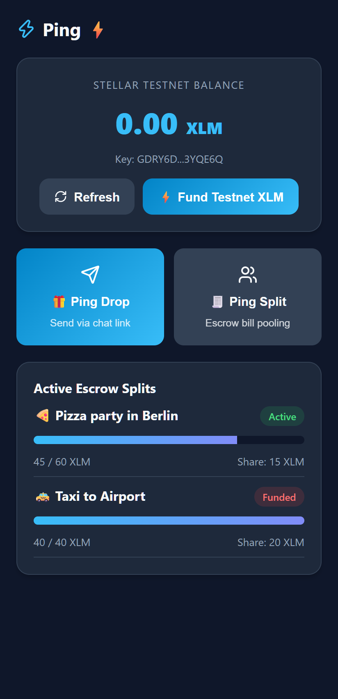
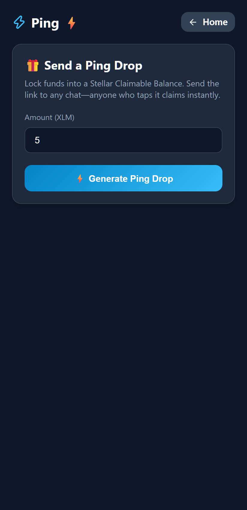
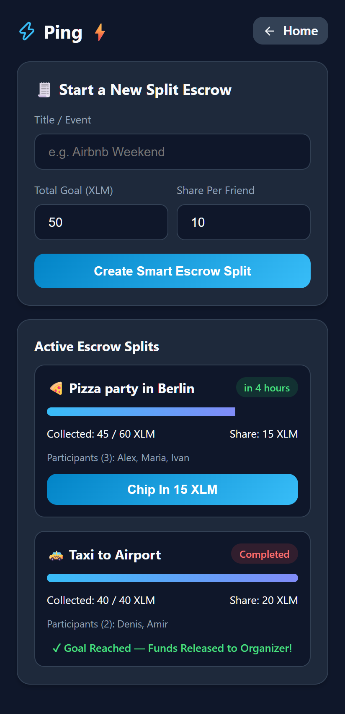
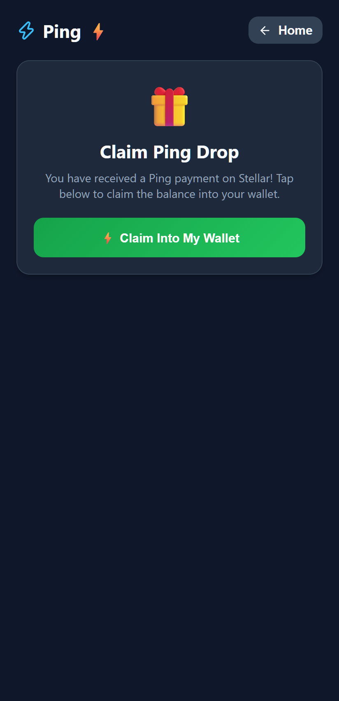

# Ping ⚡

> Money that flies like messages. Built on Stellar.

Ping is a Telegram Mini App + bot for sending money as easily as a message:

- **Ping Drop**: send money (XLM / USDC) as a link to anyone in any chat. They claim it in seconds without prior wallet registration using Stellar **Claimable Balances**. Multi-claim envelopes & automated expiry refund to sender.
- **Ping Split**: chip in for a dinner, taxi, or gift inside group chats. Funds sit in a trustless Soroban escrow smart contract: released to the organizer once the goal is reached, automatically refunded to participants if deadline expires unmet.

---

## 📱 App Preview

<p align="center">
  
  
  
  
</p>

| 1. Home & Wallet | 2. Send Drop Link | 3. Smart Escrow Split | 4. One-Tap Claim |
| :---: | :---: | :---: | :---: |
| Native Testnet wallet with Friendbot faucet & live balance | Generate instant claim link with claimable balance | Trustless group pooling with live progress & auto-refund | Direct claim into wallet with Telegram haptic feedback |

---

## Monorepo Structure

| Path | Description |
|---|---|
| `contracts/split-escrow` | Soroban smart contract for Ping Split in Rust with full test suite |
| `apps/bot` | Telegram bot (grammY + TS) & Express API: Telegram initData HMAC validation, deep links, Horizon/RPC |
| `apps/miniapp` | Telegram Mini App (React + Vite + TS + Lucide): Wallet, Send Drop, Claim Drop, Group Splits |
| `docs/` | Architecture specification and project roadmap |

---

## Getting Started

### 1. Smart Contract (`contracts/split-escrow`)

Prerequisites: Rust stable & `wasm32-unknown-unknown` target.

```bash
cd contracts/split-escrow
cargo test
```

### 2. Telegram Bot & Backend API (`apps/bot`)

Prerequisites: Node.js 20+.

```bash
cd apps/bot
npm install
npm run build
npm run dev
```

Configured via environment variables:
- `BOT_TOKEN`: Telegram Bot token from @BotFather
- `MINIAPP_URL`: URL of the deployed Telegram Mini App
- `PORT`: HTTP API port (default: `3000`)
- `HORIZON_URL`: Stellar Horizon endpoint (default: `https://horizon-testnet.stellar.org`)

### 3. Telegram Mini App (`apps/miniapp`)

```bash
cd apps/miniapp
npm install
npm run build
npm run dev
```

Supports in-browser testnet keypair generation, Friendbot testnet funding, Claimable Balance creation, and interactive Split escrow management.

---

## License
MIT
